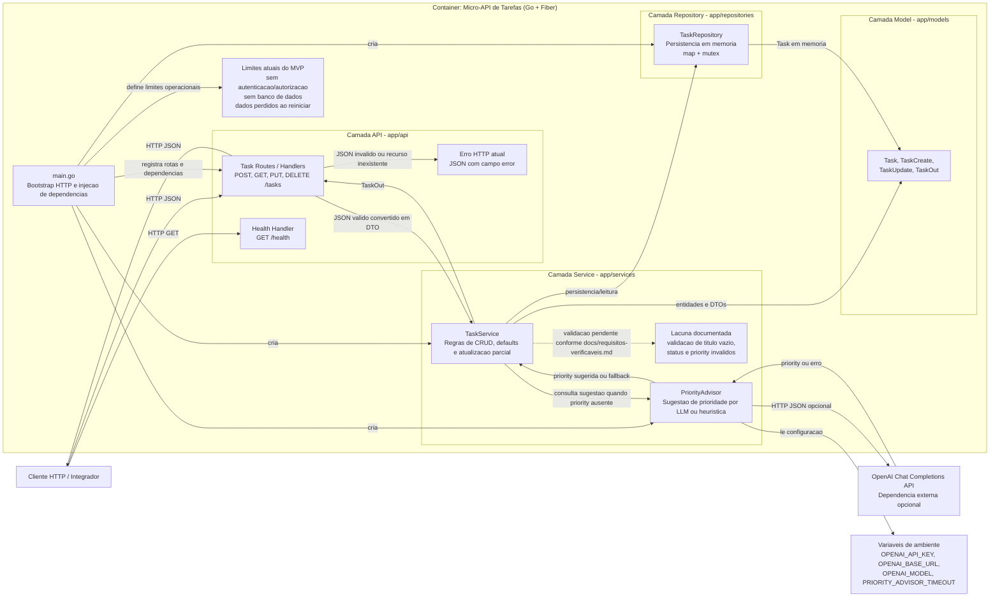
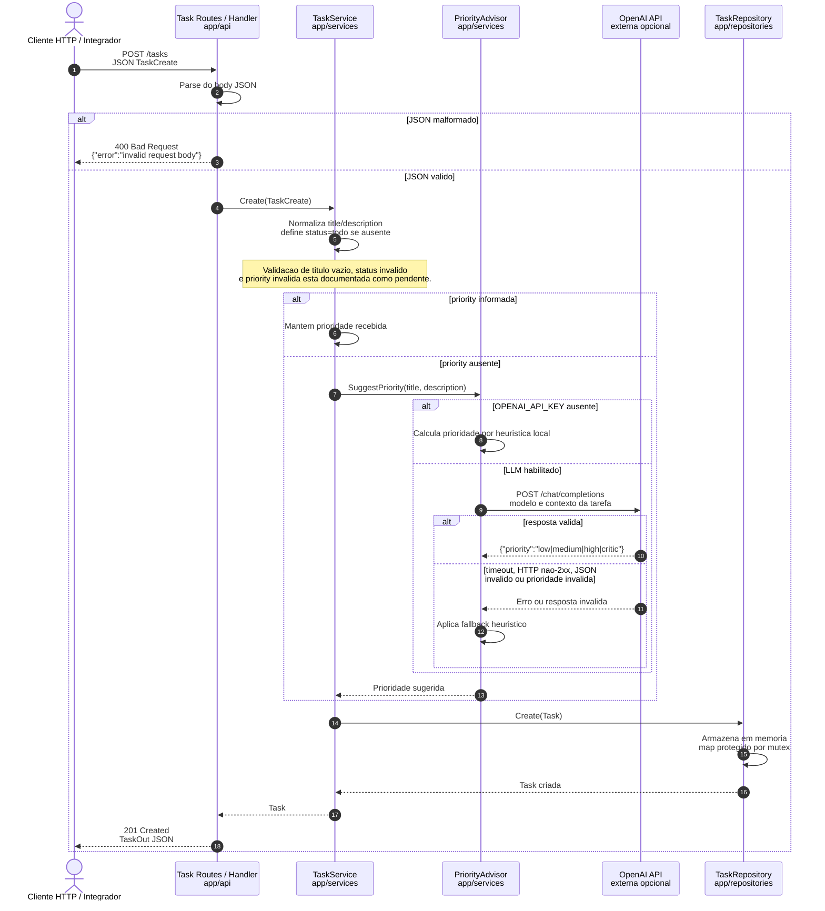
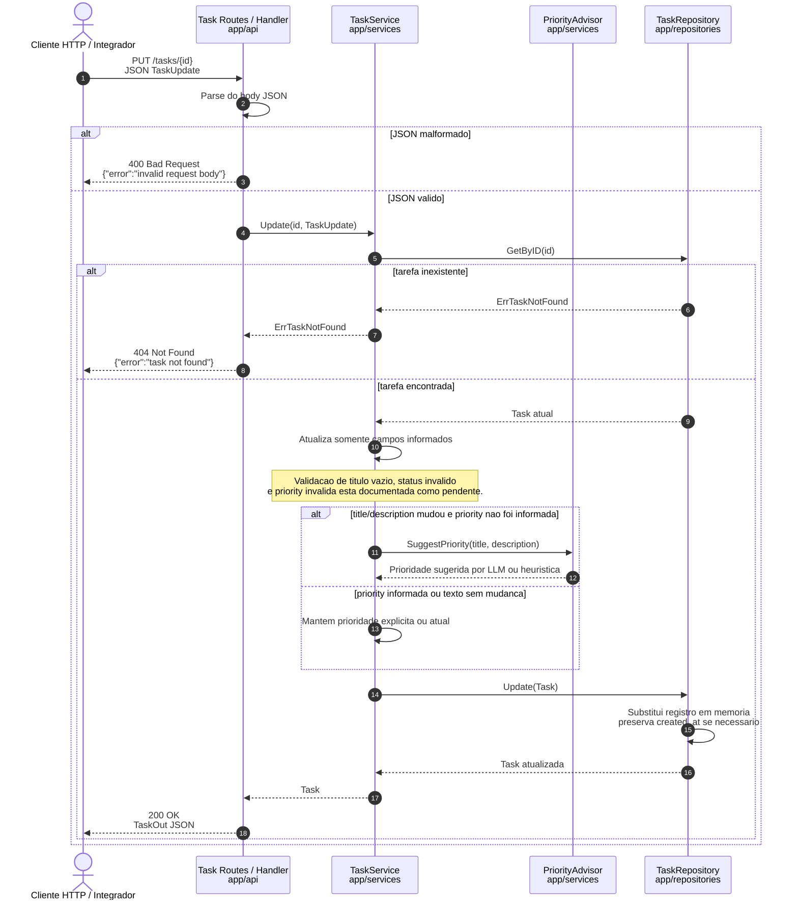

# Micro-API de Tarefas com Priorização Assistida por IA

API REST em Go (Fiber) para gestão de tarefas com sugestão de prioridade por heurística local e integração opcional com LLM.

## Objetivo

- Criar, listar, atualizar e excluir tarefas
- Padronizar status e niveis de prioridade
- Sugerir prioridade automaticamente com fallback seguro

## Stack

- Go `1.25+`
- Fiber `v2`
- Arquitetura em camadas: `api -> services -> repositories`
- Persistência em memória (map com mutex)

## Estrutura do Projeto

```text
app/
  api/                # Handlers e rotas HTTP
  models/             # Entidades e DTOs
  repositories/       # Persistência em memoria
  services/           # Regras de negócio + PriorityAdvisor
  main.go             # Bootstrap HTTP
docs/
tests/
```

## Diagramas de Arquitetura

Os diagramas estao versionados em Mermaid no diretorio `docs/diagramas` e representam o estado atual do MVP. Eles foram ajustados a partir da estrutura real do projeto: API em Go/Fiber, separacao em camadas, persistencia em memoria e integracao opcional com LLM.

### Como Ler os Diagramas

- A visao estrutural mostra quais componentes existem hoje e quais responsabilidades pertencem a cada camada.
- As visoes comportamentais mostram jornadas tecnicas ja presentes no codigo: criacao e atualizacao de tarefas.
- Fluxos marcados como lacuna documentada nao devem ser assumidos como implementados por agentes de desenvolvimento.
- Banco de dados, autenticacao/autorizacao e persistencia duravel nao fazem parte do MVP atual.

### Visao Estrutural - Componentes

Fonte: [`docs/diagramas/arquitetura-componentes.mmd`](docs/diagramas/arquitetura-componentes.mmd)



### Visao Comportamental - Criacao de Tarefa

Fonte: [`docs/diagramas/comportamental-criacao-tarefa.mmd`](docs/diagramas/comportamental-criacao-tarefa.mmd)



### Visao Comportamental - Atualizacao de Tarefa

Fonte: [`docs/diagramas/comportamental-atualizacao-tarefa.mmd`](docs/diagramas/comportamental-atualizacao-tarefa.mmd)



## Reprodução Rápida (Máquina Limpa)

### Pré-requisitos

- Go `1.25.x` instalado (`go version`)
- Git
- PowerShell (Windows)

### Passo a passo

```powershell
git clone <url-do-repositorio>
cd "Micro API"
copy .env.example .env
.\activate-go-env.ps1
make install
make run
```

Em outro terminal:

```powershell
curl http://localhost:8080/health
curl http://localhost:8080/tasks
```

## Configuração

Arquivo recomendado: `.env` (baseado em `.env.example`).

Importante:

- A aplicação lê variáveis do ambiente do processo (`os.Getenv`).
- O script `.\activate-go-env.ps1` continua necessário: ele prepara cache local do Go e carrega o `.env` para a sessão atual.
- O `.env` e fonte de configuração local; o script apenas exporta essas variáveis para o processo.

Variáveis:

- `OPENAI_API_KEY`: chave da API OpenAI (opcional)
- `OPENAI_BASE_URL`: default `https://api.openai.com/v1`
- `OPENAI_MODEL`: default `gpt-4.1-mini`
- `PRIORITY_ADVISOR_TIMEOUT`: default `4s`

Observacao:

- Sem `OPENAI_API_KEY`, a API funciona normalmente usando apenas heurística local.

### Como apontar env (PowerShell)

Fluxo recomendado:

```powershell
copy .env.example .env
.\activate-go-env.ps1
```

Depois ajuste os valores no `.env` conforme necessidade.

Alternativa sem script (manual na sessao):

Sem LLM (somente heurística local):

```powershell
$env:OPENAI_API_KEY=""
$env:OPENAI_BASE_URL="https://api.openai.com/v1"
$env:OPENAI_MODEL="gpt-4.1-mini"
$env:PRIORITY_ADVISOR_TIMEOUT="4s"
```

Com LLM (habilitado):

```powershell
$env:OPENAI_API_KEY="<SUA_CHAVE_AQUI>"
$env:OPENAI_BASE_URL="https://api.openai.com/v1"
$env:OPENAI_MODEL="gpt-4.1-mini"
$env:PRIORITY_ADVISOR_TIMEOUT="4s"
```

## Comandos de Desenvolvimento

```powershell
make install
make run
make test
```

Equivalentes diretos:

```powershell
go mod download
go run ./app
go test ./...
```

## Endpoints

Base URL local: `http://localhost:8080`

### Healthcheck

- `GET /health`
- `200 OK`

Exemplo de resposta:

```json
{
  "status": "ok",
  "timestamp": "2026-05-01T00:00:00Z"
}
```

### Tasks

- `POST /tasks`
- `GET /tasks` (lista todas as tarefas; filtros nao fazem parte do contrato atual do MVP)
- `GET /tasks/:id`
- `PUT /tasks/:id`
- `DELETE /tasks/:id`

Status esperados:

- Criação: `201`
- Leitura/listagem: `200`
- Exclusão: `204`
- Não encontrado: `404`
- JSON inválido: `400`

Formato atual de erro:

```json
{
  "error": "mensagem tecnica curta"
}
```

Exemplo de criação:

```bash
curl -X POST http://localhost:8080/tasks \
  -H "Content-Type: application/json" \
  -d "{\"title\":\"Corrigir bug de login\",\"description\":\"Erro 500 em producao\"}"
```

Exemplo de listagem:

```bash
curl http://localhost:8080/tasks
```

## Uso da IA na Priorização

`PriorityAdvisor` opera em 2 modos:

1. Heurística local (sempre disponivel)
2. LLM opcional (quando `OPENAI_API_KEY` está configurada)

### Contrato esperado do LLM

Resposta de conteudo JSON com:

```json
{"priority":"low|medium|high|critic"}
```

Observacao: o MVP atual usa a sugestao internamente na criacao/atualizacao de tarefas quando `priority` nao e informada. Endpoint dedicado de sugestao e justificativa curta nao fazem parte do contrato atual.

### Fallback Seguro

Se a chamada externa falhar, a API não quebra o CRUD e aplica heurística local nos casos:

- timeout
- HTTP nao-2xx
- JSON invalido
- `choices` vazio
- prioridade fora do contrato

### Exemplos de Heurística

- `"incidente em producao"` -> tende a `critic`
- `"urgente para cliente"` -> tende a `high`
- `"melhoria de texto"` -> tende a `medium`
- `"item opcional de backlog"` -> tende a `low`

### Custo e Latência

- Heurística local: custo externo zero, latência mínima
- LLM: maior latência/custo por chamada; recomendado quando precisa de contexto semântico adicional

### Segurança

- Nunca versionar `OPENAI_API_KEY`
- Use `.env` local
- Em ausência de credencial, comportamento padrão continua funcional

## Testes

Executar suite:

```powershell
make test
```

Ou:

```powershell
go test ./...
```

Cobertura atual inclui cenários de:

- rotas (`2xx`, `4xx`)
- serviço (CRUD + casos de erro)
- repositório (ordenação e atualização)
- priority advisor (heurística, sucesso LLM e fallback)

Observação de execução:

- `go test ./...` roda sem depender de chamadas reais ao provedor LLM.
- Durante testes, o `PriorityAdvisor` usa heurística por padrão.

### Troubleshooting (Windows)

Se `go test ./...` falhar com erro de permissão no cache (ex.: `Access is denied` em `AppData\Local\go-build`), configure o cache e GOPATH uma vez:

```powershell
go env -w GOCACHE="$env:USERPROFILE\\go-build-cache"
go env -w GOPATH="$env:USERPROFILE\\go"
```

Depois disso, execute normalmente:

```powershell
go test ./...
```

## Limitações do MVP

- Persistência apenas em memória (sem dados apos restart)
- Sem autenticação/autorização
- Sem migrações de banco
- Sem observabilidade completa (métricas/tracing)

## Licença

Este projeto esta licenciado sob a MIT License. Veja o arquivo `LICENSE` para detalhes.
